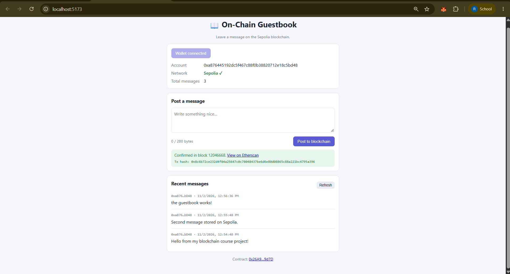
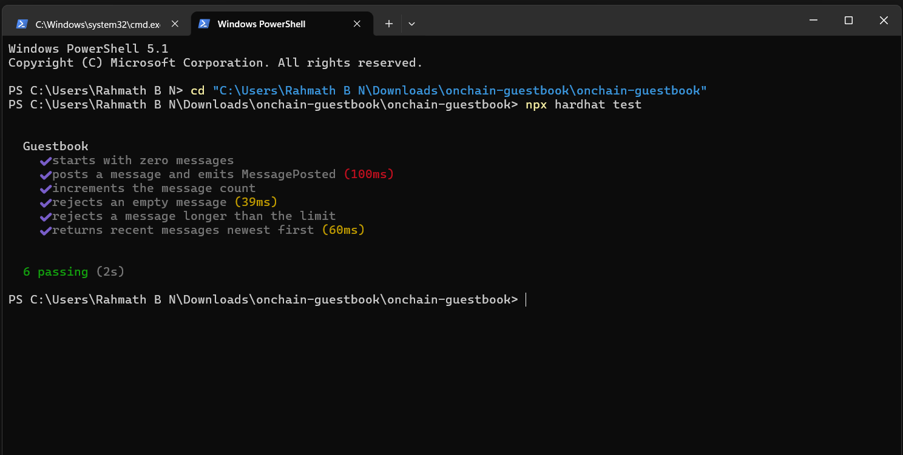
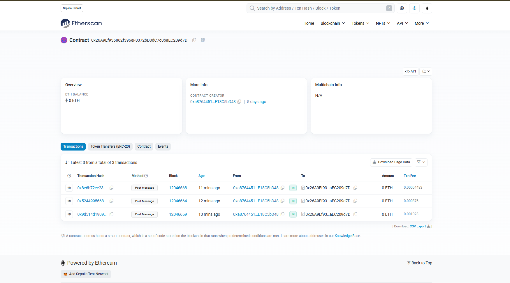

# 📖 On-Chain Guestbook

A simple decentralized application (DApp) where anyone can connect a MetaMask wallet, post a short message to the Ethereum **Sepolia** testnet, and see the list of recent messages and the total message count. Built as a university blockchain course project.

## Features
- Post a message (1–280 bytes) stored permanently on-chain
- `MessagePosted` event emitted for every message
- View the total message count and the most recent messages (newest first)
- MetaMask connection with connected address, network check and one-click "Switch to Sepolia"
- Transaction status shown on the page (waiting, pending, confirmed) with tx hash and Etherscan link
- Error handling: no wallet, wrong network, rejected transaction, insufficient funds, contract reverts
- Responsive layout, no frontend build step

## Tech stack
- **Solidity** ^0.8.24 (smart contract)
- **Hardhat 2** (compile, test, deploy)
- **ethers.js v6** (frontend and blockchain interaction)
- **HTML / CSS / vanilla JavaScript** (frontend)
- **MetaMask** + **Sepolia** testnet

## Project structure
```
contracts/Guestbook.sol     smart contract
test/Guestbook.test.js      Hardhat tests
scripts/deploy.js           deployment script
frontend/                   index.html, style.css, app.js, config.js
```

## Deploy the smart contract

1. **Prerequisites:** Node.js 20 or 22 LTS, MetaMask.
2. **Install:**
   ```bash
   git clone https://github.com/rahmathbn187273/onchain-guestbook.git
   cd onchain-guestbook
   npm install
   ```
3. **Run the tests:**
   ```bash
   npx hardhat test
   ```
4. **Get an RPC URL:** create a free app on [Alchemy](https://www.alchemy.com/) or [Infura](https://www.infura.io/) for the Sepolia network and copy the HTTPS URL.
5. **Create a throwaway wallet:** in MetaMask, add a NEW account used only for testing (never use a wallet that holds real funds).
6. **Get Sepolia test ETH** for that account from a Sepolia faucet (search "Sepolia faucet"; examples include the Google Cloud Web3 faucet, the Alchemy faucet and the PoW faucet).
7. **Configure `.env`:**
   ```bash
   cp .env.example .env     # Windows: copy .env.example .env
   ```
   Fill in `SEPOLIA_RPC_URL` and `PRIVATE_KEY` (test wallet only). `.env` is git-ignored; never commit it.
8. **Deploy:**
   ```bash
   npx hardhat run scripts/deploy.js --network sepolia
   ```
9. Copy the printed contract address into `frontend/config.js` (`CONTRACT_ADDRESS`).

## Run the frontend
```bash
npm run frontend
```
Open http://localhost:5173 in a browser with MetaMask installed. (Serve it over http://localhost rather than opening the file directly with `file://`.)

## Deployment info
| Item | Value |
|------|-------|
| Network | Sepolia testnet (chain ID 11155111) |
| Contract address | `0x26A9Ef936862f396eF0372bD0dC7c0baEC209d7D` |
| Etherscan | https://sepolia.etherscan.io/address/0x26A9Ef936862f396eF0372bD0dC7c0baEC209d7D |
| Deployment tx | https://sepolia.etherscan.io/tx/0xadf0384e33a718db46538565d73cf57c138029436b275a86c7887c9fbfc0207c |

## Screenshots






## License
MIT
